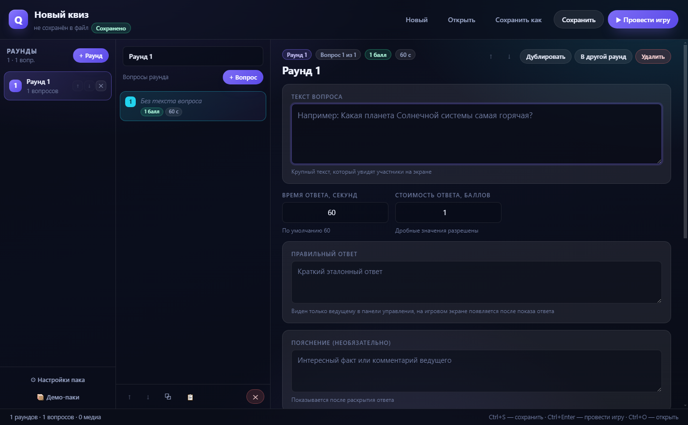
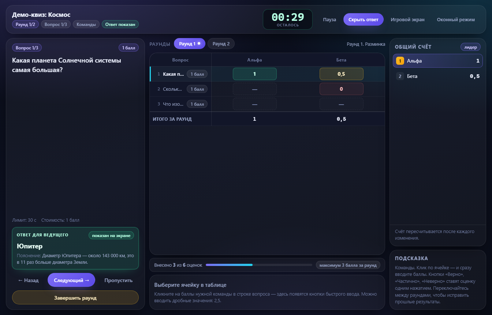
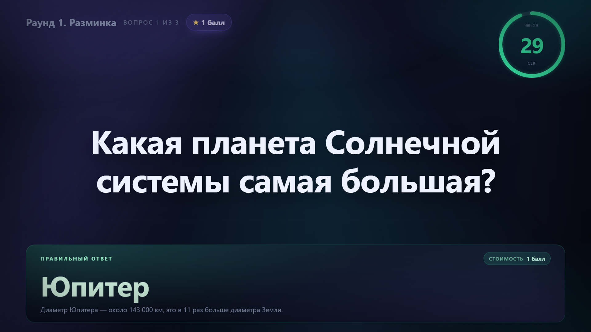
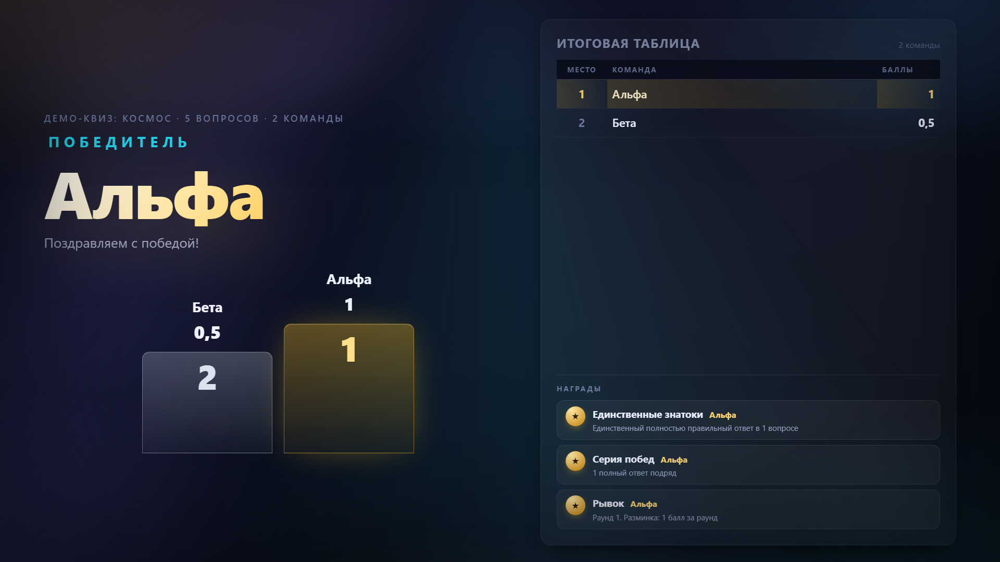

# QuizMaster — приложение для офлайн-квизов

QuizMaster помогает провести квиз без интернета и облачных сервисов. Ведущий создаёт
игровой пак (`.quizpack`), запускает игру, на проекторе или втором мониторе открывается
игровое окно с вопросами и таймером, а на ноутбуке ведущего — панель управления с таблицей
баллов. После игры показываются итоги, статистика и награды.

Версия приложения — 1.3.0.

## Что нового в 1.3.0

- **Картинка к правильному ответу** — постер или кадр, который показывается вместе с ответом.
- **Обложка раунда** — картинка на заставке раунда.
- **Фоновая музыка пака** — необязательный плейлист: играет перед вопросами и на итогах,
  в вопросах молчит. Громкость и пауза — в панели ведущего.
- **Фанфары** — встроенный звук один раз играет при первом показе итогов.
- **Совместимость** — паки, созданные в прежних версиях, открываются как раньше.

## Что нужно для работы

| Что | Требование |
|---|---|
| Операционная система | Windows 10 или Windows 11, 64-битная (x64) |
| Свободное место на диске | около 2 ГБ для установки зависимостей и сборки; для данных приложения — несколько мегабайт |
| Интернет | нужен только при установке зависимостей (`INSTALL.bat`) и при сборке установщика (`BUILD.bat`); для создания паков и проведения игры не нужен |
| Node.js | нужен только для запуска из папки проекта и для сборки; установленной версии приложения (из установщика) Node.js не требуется |
| Второй монитор или проектор | не обязателен; без него игра открывается на основном экране |

## Три окна приложения

| Окно | Что в нём | Когда открывается |
|---|---|---|
| **Редактор паков** | создание паков: раунды, вопросы, время, баллы, медиа, сохранение | сразу при запуске приложения |
| **Панель ведущего** | лобби, состав участников, ход игры, таймер, внесение баллов, итоги | после нажатия «Провести игру» в редакторе |
| **Игровой экран** | то, что видят участники: вопрос, таймер, медиа, правильный ответ, итоги | после нажатия «Провести игру» в редакторе |

Как это выглядит:

| Редактор паков | Панель ведущего |
|---|---|
|  |  |

| Игровой экран с вопросом | Итоги игры |
|---|---|
|  |  |

## Быстрый старт

### Вариант 1. Запуск из папки проекта (нужен Node.js)

1. Установите Node.js LTS с сайта `nodejs.org` (кнопка «LTS»), нажимая «Далее» без изменений.
   Подробная инструкция — в [docs/BUILD_GUIDE.md](docs/BUILD_GUIDE.md).
2. Откройте папку проекта и дважды щёлкните `INSTALL.bat`.
   Что произойдёт: откроется окно консоли, приложение проверит Node.js и npm и скачает
   зависимости. В конце появится надпись «Готово! Зависимости установлены. Теперь запускайте
   START.bat». Первый запуск занимает примерно 3–10 минут.
   Если появилось «[ОШИБКА] Node.js не найден» — установите Node.js LTS и запустите файл снова.
3. Дважды щёлкните `START.bat`.
   Что произойдёт: в консоли появятся строки «Собираю приложение…» и «Запускаю QuizMaster…»,
   затем откроется окно «QuizMaster — редактор» с панелью «Раунды» слева и пустым паком
   «Новый квиз». Запуск занимает около 10–60 секунд.
4. Окно консоли не закрывайте во время игры: вместе с ним закроется приложение.
   Для выхода закройте окна QuizMaster, затем закройте окно консоли.

Если папка `node_modules` отсутствует, `START.bat` сам предложит выполнить установку
(запустит `INSTALL.bat`).

### Вариант 2. Установленная версия (без Node.js)

1. Если установщик ещё не собран, соберите его один раз командой `BUILD.bat`
   (см. раздел [«Сборка установщика»](#сборка-установщика)).
2. Запустите `release\QuizMaster-1.3.0-Setup.exe`. Установка идёт автоматически, несколько
   секунд, без вопросов и без прав администратора: приложение ставится для текущего
   пользователя и запускается сразу после установки.
   Если установщик не запускается или его блокирует антивирус — распакуйте
   `release\QuizMaster-1.3.0-portable.zip` в любую папку и запустите `QuizMaster.exe`
   оттуда (установка не требуется).
3. Запустите QuizMaster с рабочего стола или из меню «Пуск». Откроется окно редактора паков.

На этом компьютере больше ничего устанавливать не нужно: приложение работает без Node.js
и без интернета.

## Как создать пак

1. В редакторе нажмите «Новый» (Ctrl+N) или откройте готовый пример: «Демо-паки» → «Открыть».
2. Введите название пака в верхней строке. Кнопка «Настройки пака» задаёт название, описание,
   тему оформления игрового экрана, фоновую музыку и значения по умолчанию для новых вопросов
   (время и баллы).
3. В панели «Раунды» нажимайте «+ Раунд», переименовывайте раунд в поле над списком вопросов.
4. В панели вопросов нажимайте «+ Вопрос» и заполняйте:
   - текст вопроса;
   - время ответа (от 5 до 3600 секунд);
   - стоимость ответа в баллах (целые или дробные значения, например 2,5);
   - правильный ответ (виден ведущему, на игровом экране появляется по кнопке «Показать ответ»);
   - пояснение (необязательно, показывается после раскрытия ответа);
   - изображение, аудио и видео (кнопки «Добавить»).
5. Порядок вопросов меняется кнопками ↑ и ↓, копия создаётся кнопкой «Дублировать»,
   перенос в другой раунд — кнопкой «В другой раунд».
6. Нажмите «Сохранить» (Ctrl+S) и выберите место для файла `.quizpack`.
   Кнопка «Сохранить как» создаёт копию файла под новым именем.
7. Изменения автоматически сохраняются в черновик: если приложение закроется, при следующем
   запуске появится надпись «Восстановлен несохранённый черновик».

Тема оформления выбирается там же, в «Настройках пака» → «Тема оформления». В окне есть живой
предпросмотр игрового экрана. Доступны 14 тем в четырёх группах. Тема меняет только игровой экран
и сохраняется в паке; если тема не выбрана, используется «Студия».

Подробное описание всех действий — в [docs/user-guide.md](docs/user-guide.md).

## Как провести игру

1. В редакторе нажмите «▶ Провести игру» (Ctrl+Enter). Пак сохранится (если файл ещё
   не сохранён, приложение попросит выбрать место), откроются панель ведущего и игровой экран.
2. В панели ведущего выберите режим «Команды» или «Индивидуальные участники», введите названия
   и нажмите «Добавить» (или Enter). Названия можно исправлять и удалять.
3. Проверьте блок «Экраны»: выберите монитор для игрового окна, при необходимости нажмите
   «Открыть игровое окно» и включите «Полный экран».
4. Нажмите «Начать игру». На игровом экране появится заставка раунда, в панели — карточка
   раунда с кнопкой «Начать раунд →».
5. Дальше ведите игру кнопками панели: «Следующий →», «← Назад», «Пропустить», «Пауза»,
   «Показать ответ», «Завершить раунд». Баллы вносятся кликом по ячейке таблицы.
6. После последнего раунда нажмите «Показать итоги»: появятся итоговая таблица, победитель,
   статистика и награды.

## Сборка установщика

1. Один раз выполните `INSTALL.bat`.
2. Дважды щёлкните `BUILD.bat`. При первой сборке скачиваются инструменты сборки: нужен
   интернет и около 1 ГБ свободного места; это занимает примерно 5–10 минут.
   В конце папка `release` откроется автоматически.
3. Готовый файл — `release\QuizMaster-1.3.0-Setup.exe`. Его можно перенести на другой
   компьютер и установить без Node.js и без интернета. Рядом создаётся
   `release\QuizMaster-1.3.0-portable.zip` — запасной вариант без установки.

## Где лежат данные

| Что | Где |
|---|---|
| Данные приложения (медиатека, черновик редактора, сохранение игры) | `%APPDATA%\quizmaster` |
| Демонстрационные паки в папке проекта | `packs\` |
| Демонстрационные паки в установленной версии | `resources\packs` рядом с папкой приложения; открыть их можно в редакторе кнопкой «Демо-паки» |
| Сохранённые паки `.quizpack` | там, где вы указали при сохранении; по умолчанию диалог предлагает папку «Документы» |

Открыть папку данных можно из меню приложения: «Справка» → «Открыть папку данных».
Внутри: `media` — медиатека, `drafts` — черновик редактора, `sessions` — сохранение
незавершённой игры.

## Документация

| Файл | Для чего |
|---|---|
| [docs/BUILD_GUIDE.md](docs/BUILD_GUIDE.md) | пошаговая установка Node.js, запуск, режим разработки, сборка и установка |
| [docs/user-guide.md](docs/user-guide.md) | все действия пользователя: паки, медиа, ход игры, баллы, итоги, восстановление |
| [docs/TRANSFER_GUIDE.md](docs/TRANSFER_GUIDE.md) | перенос проекта на другой компьютер и продолжение работы |
| [docs/troubleshooting.md](docs/troubleshooting.md) | типовые ошибки и их решение |
| [docs/build.md](docs/build.md) | техническая сборка и разработка |
| [docs/architecture.md](docs/architecture.md) | архитектура приложения и формат `.quizpack` |

## Если что-то пошло не так

| Что видите | Куда смотреть |
|---|---|
| «[ОШИБКА] Node.js не найден» | [docs/BUILD_GUIDE.md](docs/BUILD_GUIDE.md), шаг «Установите Node.js LTS» |
| `npm install` завершился ошибкой | [docs/troubleshooting.md](docs/troubleshooting.md), раздел «Не устанавливаются зависимости» |
| Окно не открылось или показывает чёрный экран | [docs/troubleshooting.md](docs/troubleshooting.md), раздел «Окно не открывается или чёрный экран» |
| Не играет видео или не слышно звук | [docs/troubleshooting.md](docs/troubleshooting.md), раздел «Не слышно звук, не играет видео» |
| «Повреждённый пак» или предупреждения о контрольной сумме | [docs/troubleshooting.md](docs/troubleshooting.md), раздел «Повреждённый пак» |
| Игра не восстановилась после сбоя | [docs/troubleshooting.md](docs/troubleshooting.md), раздел «Игра не восстановилась» |
| Не собирается установщик | [docs/troubleshooting.md](docs/troubleshooting.md), раздел «Установщик не собирается» |
